# How to solve

<!-- Generated by tools/build_how_to_solve.mjs from the rules table in js/rating.js, README.md and the pictures in docs/images. -->

Every technique the Hint button knows, with a picture of it at work. It is a guide for new players, and a reference for how the hint
system and the difficulty rating think (they are the same machinery: see "Difficulty: rules, tiers and score" in the [README](../README.md)).

## The rules of the puzzle

- Draw one closed loop that goes through every cell that is not a box and not a numbered arrow, turning at right angles. It never crosses
  itself and never enters an arrow cell.
- A number with an arrow counts the boxes (shaded cells) along that arrow, to the edge of the board. Arrows can point along rows,
  columns or, in some books, diagonals.
- Boxes never touch each other along an edge.
- A dot marks a cell you know is on the loop (not a box).

## How the examples work

Each picture is a position you reach by pressing **Hint** and marking what it says, over and over, from the empty board. Every picture
shows the Hint button's own explanation and its colours: the cell being decided, the cells it looks at, and (dashed) the lines a
trial box would force. The puzzles live in a book called **armory** that is not in the book picker; click any picture to open that
puzzle in the app. Pressing Hint all the way through will show you the technique at the position pictured, and you can try the other
moves along the way too.

Techniques are listed from the one a person notices first to the one they notice last. That order is the rating system's: the solver
always takes the cheapest rule that applies, and a puzzle's difficulty is the total cost of the steps it needs. The cost is shown
beside each name.

## Bookkeeping

Three rules cost almost nothing and the hint never shows them: they tidy up what is already certain, so the other rules can look at a
clean board.

- `edgesOffShaded`: Bookkeeping: a segment touching a box is off (charged once per step in which it had something to do)
- `edgeEnds`: Bookkeeping: a segment makes both its cells loop cells (dots) (charged once per step in which it had something to do)
- `fullCells`: Bookkeeping: a loop cell with two segments takes no more (the others are off) (charged once per step in which it had something to do)

## Beginner

A puzzle is rated Beginner when the hardest thing it needs is this: clue counting, cells next to boxes, dead ends, corners and corridors, and not closing the loop early.

### shadedNeighbor

*Beginner, cost 1*

Cells next to a shaded cell are loop

<a href="https://joshmermelstein.com/yajilin/index.html?book=armory&puzzle=1">
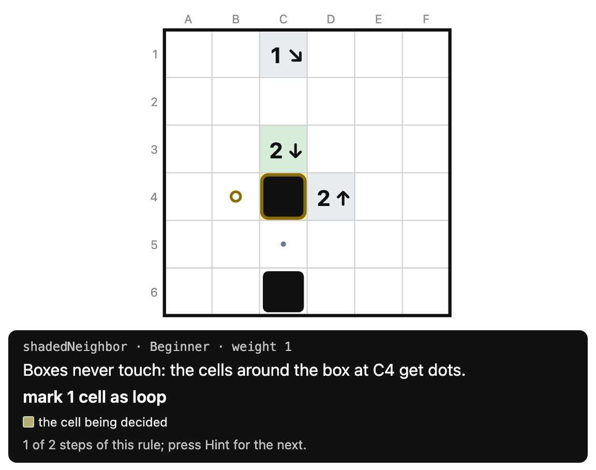</a>

*Y6x6_s8005_14, 6×6: the board after 1 earlier hint. Click the picture to open this puzzle and press Hint yourself.*

Hint says: "Boxes never touch: the cells around the box at C4 get dots."

---

### clueDone

*Beginner, cost 2*

A clue already has all its shaded cells: the rest of its line is loop

<a href="https://joshmermelstein.com/yajilin/index.html?book=armory&puzzle=2">
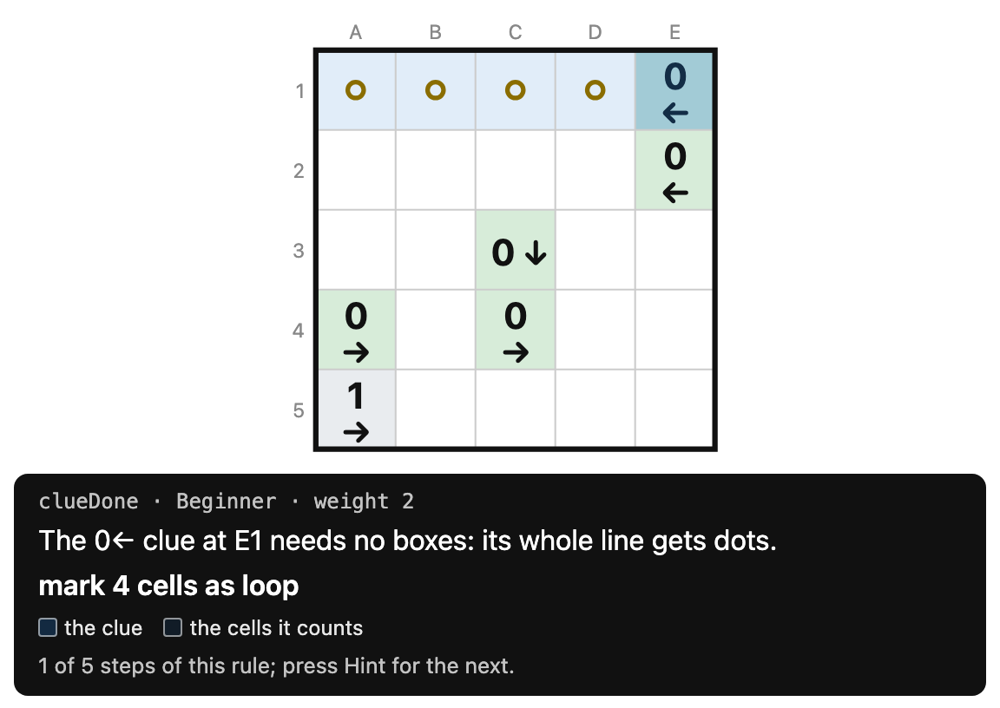</a>

*BONUS-INTRO-001, 5×5: the empty board. Click the picture to open this puzzle and press Hint yourself.*

Hint says: "The 0← clue at E1 needs no boxes: its whole line gets dots."

---

### clueFull

*Beginner, cost 2*

A clue needs as many shaded cells as it has open cells left: shade them all

<a href="https://joshmermelstein.com/yajilin/index.html?book=armory&puzzle=3">
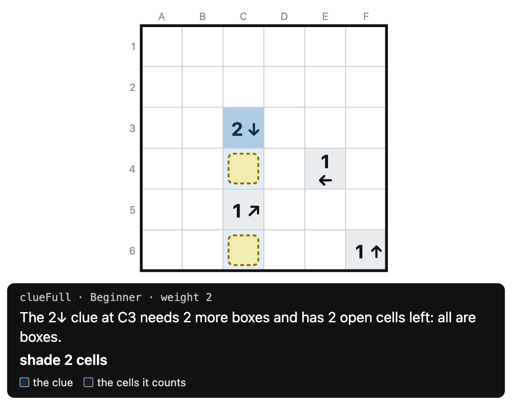</a>

*Y6x6_s9005_35, 6×6: the empty board. Click the picture to open this puzzle and press Hint yourself.*

Hint says: "The 2↓ clue at C3 needs 2 more boxes and has 2 open cells left: all are boxes."

---

### clueTight

*Beginner, cost 3*

A clue still needs r >= 2 boxes and its open cells (not touching a box) form odd-length runs that hold exactly r boxes between them (a run of 2m - 1 cells holds m, on every other cell): boxes go on every other cell of each run, dots between them. The special case of `cluePlacements` seen at a glance; Nikoli's setters use it a lot

<a href="https://joshmermelstein.com/yajilin/index.html?book=armory&puzzle=1">
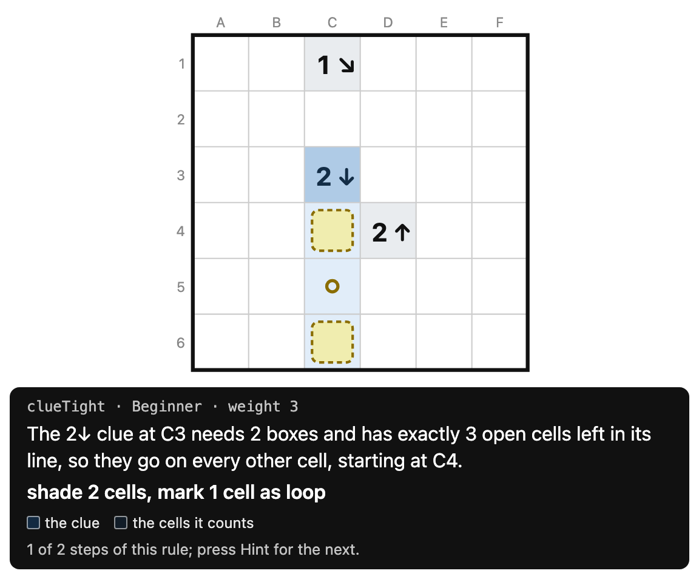</a>

*Y6x6_s8005_14, 6×6: the empty board. Click the picture to open this puzzle and press Hint yourself.*

Hint says: "The 2↓ clue at C3 needs 2 boxes and has exactly 3 open cells left in its line, so they go on every other cell, starting at C4."

---

### rangeSameOne

*Beginner, cost 3*

Two clues in a line point the same way with exactly one cell between them: that cell holds (first number - second number) boxes, so it is a box if the difference is 1 and a dot if it is 0

<a href="https://joshmermelstein.com/yajilin/index.html?book=armory&puzzle=4">
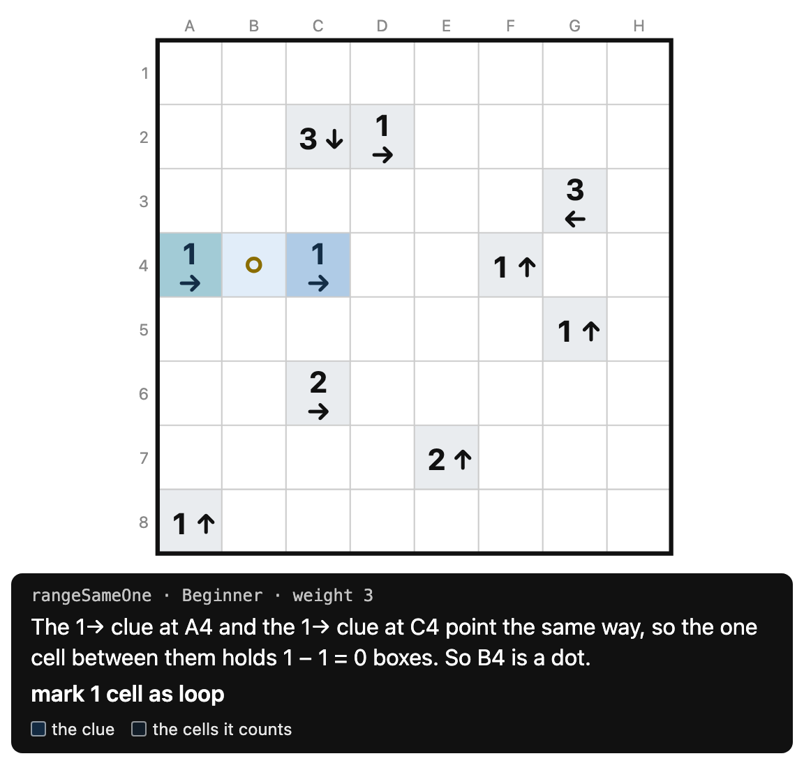</a>

*BONUS-NOZEROS-8X8-013, 8×8: the empty board. Click the picture to open this puzzle and press Hint yourself.*

Hint says: "The 1→ clue at A4 and the 1→ clue at C4 point the same way, so the one cell between them holds 1 − 1 = 0 boxes. So B4 is a dot."

---

### deadEnd

*Beginner, cost 4*

A cell with fewer than two exits cannot be on the loop: shaded

<a href="https://joshmermelstein.com/yajilin/index.html?book=armory&puzzle=5">
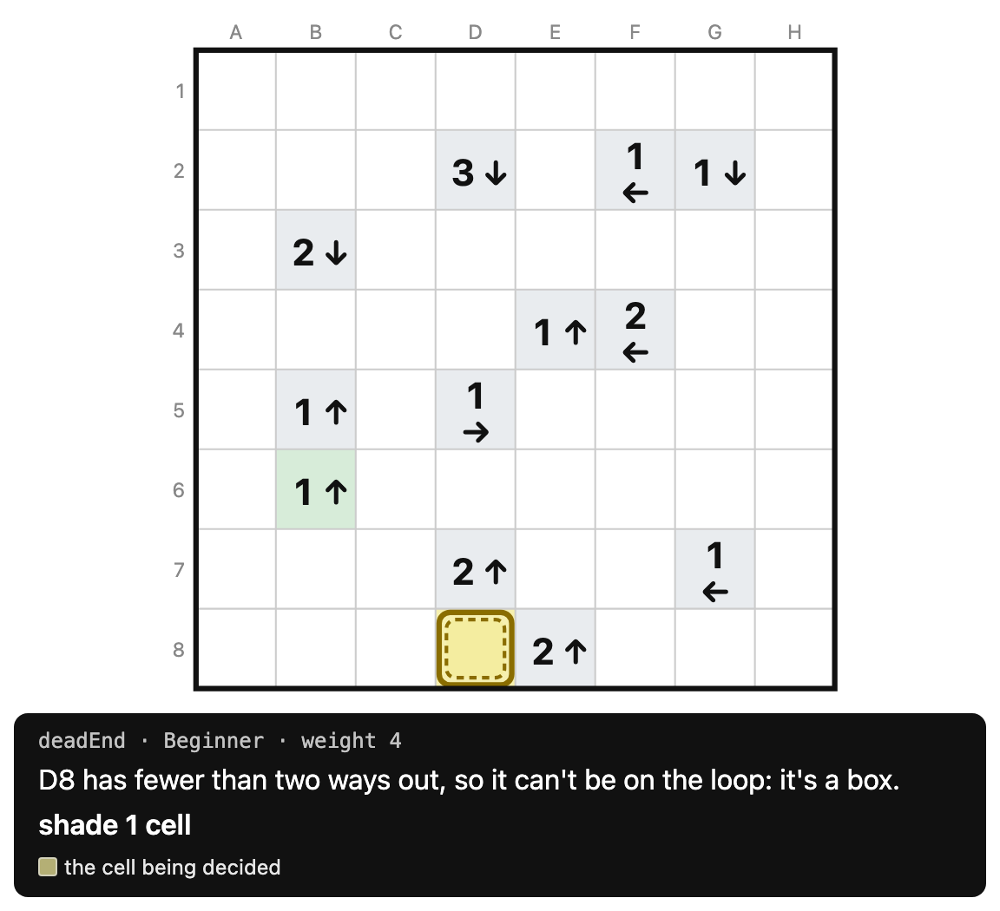</a>

*Y8x8_s9163_5, 8×8: the empty board. Click the picture to open this puzzle and press Hint yourself.*

Hint says: "D8 has fewer than two ways out, so it can't be on the loop: it's a box."

---

### forcedExits

*Beginner, cost 4*

A loop cell with exactly two exits left uses both

<a href="https://joshmermelstein.com/yajilin/index.html?book=armory&puzzle=6">
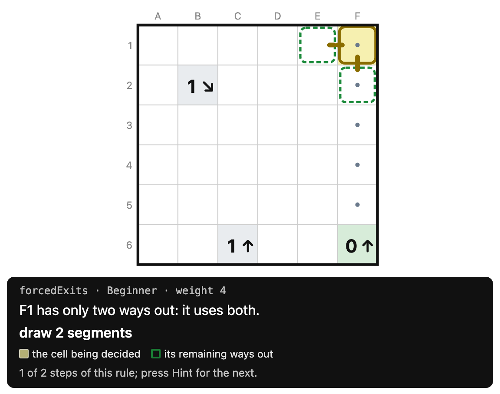</a>

*Y6x6_s32001_2, 6×6: the board after 1 earlier hint. Click the picture to open this puzzle and press Hint yourself.*

Hint says: "F1 has only two ways out: it uses both."

---

### tightCell

*Beginner, cost 5*

A neighbour has only two cells it can ever connect to (board edge and clue cells around it: a corner, clues touching diagonally, a gap between two clues): a box here would leave it one way out and it cannot be a box itself, so this cell gets a dot. Seen at a glance. Beginner since 2026-11-21: it is board geometry, and it was the only Medium step in a quarter of the 8x8 book

<a href="https://joshmermelstein.com/yajilin/index.html?book=armory&puzzle=7">
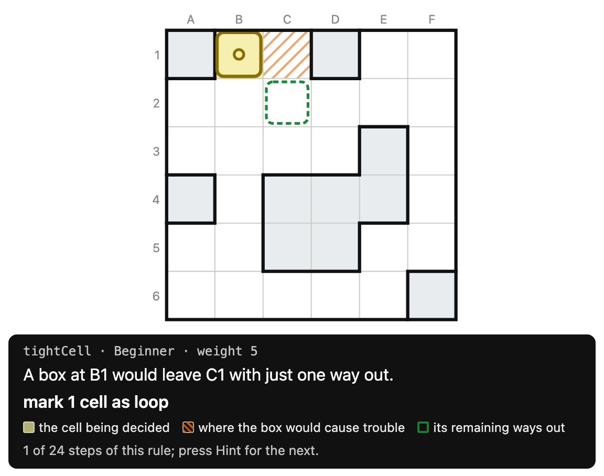</a>

*Y6x6_s9001_1, 6×6: the empty board. Click the picture to open this puzzle and press Hint yourself.*

Hint says: "A box at B1 would leave C1 with just one way out."

---

### noEarlyClose

*Beginner, cost 6*

A segment joining the two ends of one path would close the loop while other loop cells are outside it

*No picture: It only ever rules a segment out ("no line joins these two ends"), and the Hint button has nothing to show for that, since you cannot mark "no segment". It appears in a hint as the "Relies on" line instead, and `sameSegmentExits` and `closingCell` are its two visible forms.*

---

### sameSegmentExits

*Beginner, cost 7*

A loop cell has three ways out and two of them lead to the two ends of one path: using both would close the loop early, so it uses the third. The same kind of step as `noEarlyClose`

<a href="https://joshmermelstein.com/yajilin/index.html?book=armory&puzzle=8">
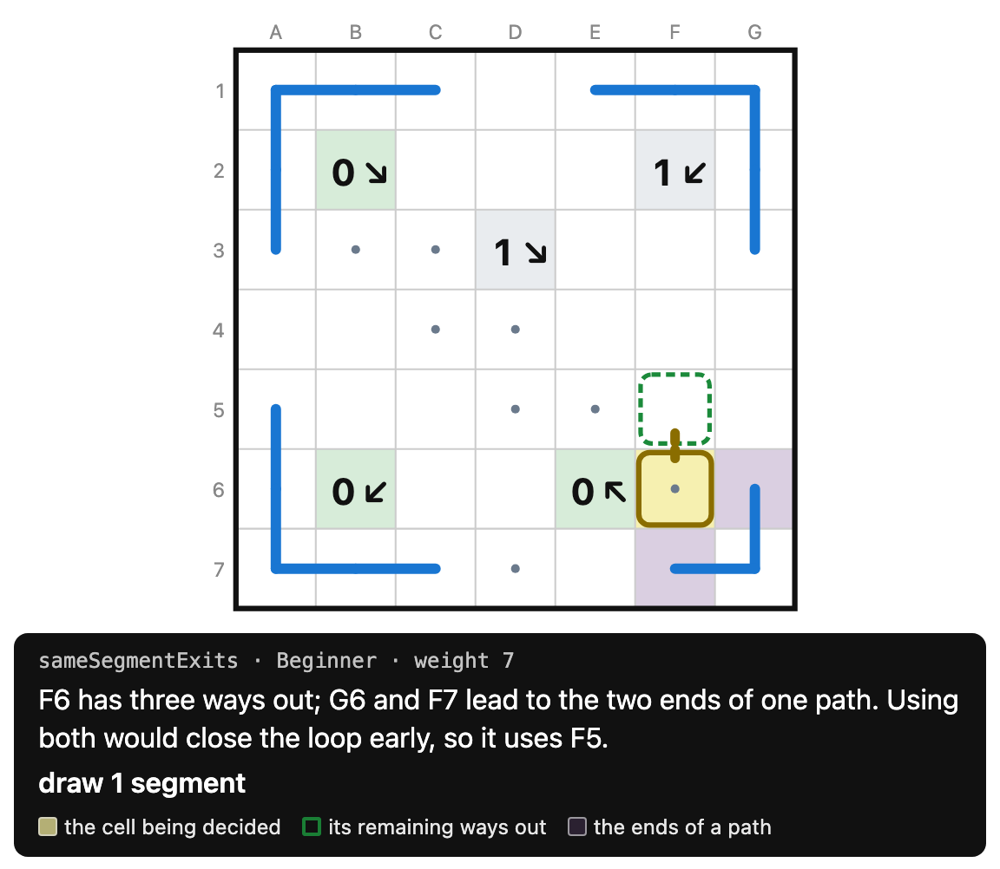</a>

*Y7x7_s22006_1, 7×7: the board after 16 earlier hints. Click the picture to open this puzzle and press Hint yourself.*

Hint says: "F6 has three ways out; G6 and F7 lead to the two ends of one path. Using both would close the loop early, so it uses F5."

---

### closingCell

*Beginner, cost 7*

A cell has only two ways out and both lead to the two ends of one path: using them would close the loop early, so the cell is a box. The same kind of step as `noEarlyClose`

<a href="https://joshmermelstein.com/yajilin/index.html?book=armory&puzzle=9">
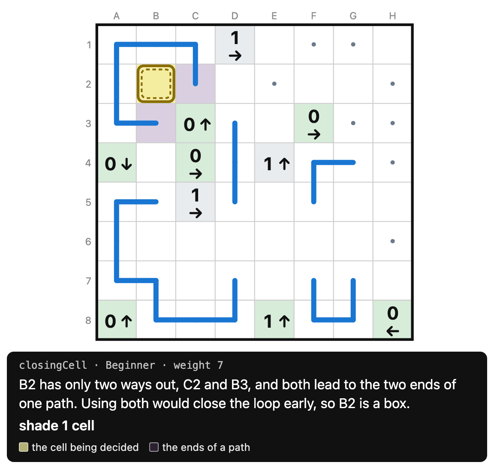</a>

*8X8-0764, 8×8: the board after 22 earlier hints. Click the picture to open this puzzle and press Hint yourself.*

Hint says: "B2 has only two ways out, C2 and B3, and both lead to the two ends of one path. Using both would close the loop early, so B2 is a box."

---

## Medium

A puzzle is rated Medium when the hardest thing it needs is this: placing a clue's boxes, and imagining one box, dot or segment and following a short chain of forced lines.

### deadEndNeighbor

*Medium, cost 10*

Shading a cell would strand a neighbour (given the marks so far): the cell is loop

<a href="https://joshmermelstein.com/yajilin/index.html?book=armory&puzzle=10">
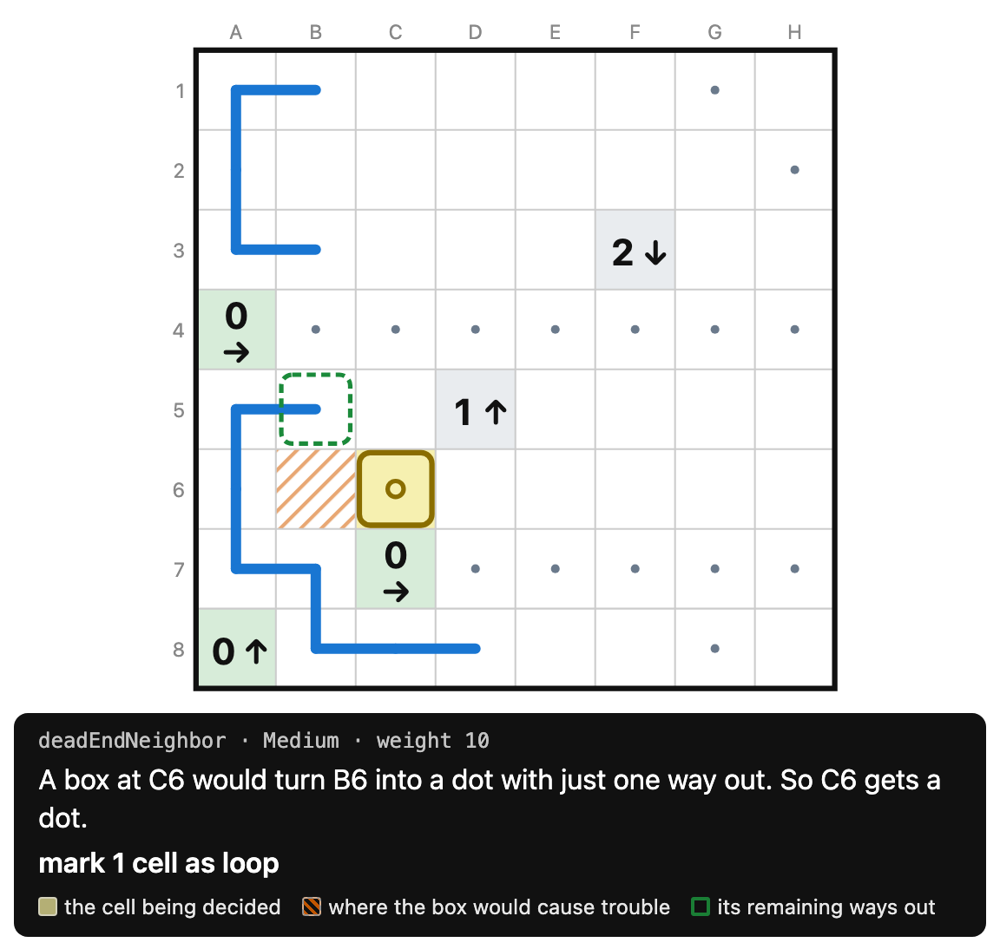</a>

*SPARSE-8X8-ORTHOGONAL-30, 8×8: the board after 13 earlier hints. Click the picture to open this puzzle and press Hint yourself.*

Hint says: "A box at C6 would leave B6 with just one way out."

---

### cluePlacements

*Medium, cost 12*

Try every way to place the clue's boxes without two touching: a cell they all use is shaded, a cell none uses is loop

<a href="https://joshmermelstein.com/yajilin/index.html?book=armory&puzzle=10">
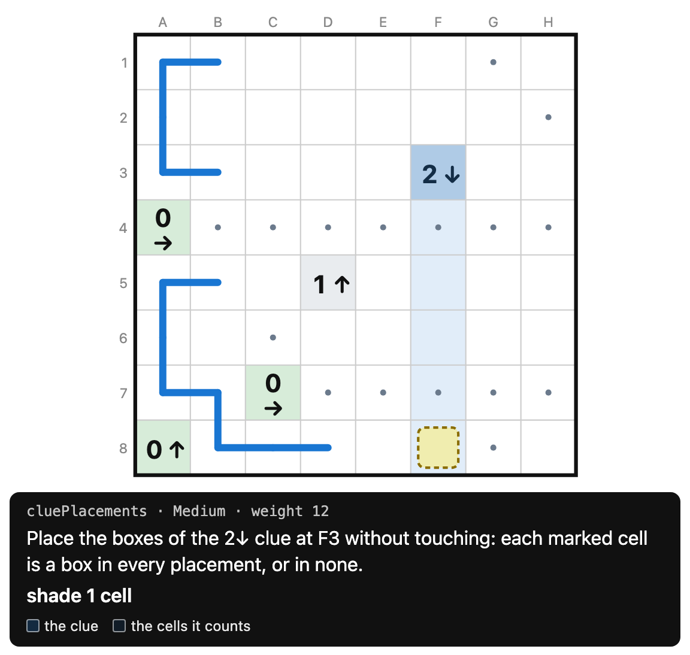</a>

*SPARSE-8X8-ORTHOGONAL-30, 8×8: the board after 14 earlier hints. Click the picture to open this puzzle and press Hint yourself.*

Hint says: "Place the boxes of the 2↓ clue at F3 without touching: each marked cell is a box in every placement, or in none."

---

### placementDeadEnd

*Medium, cost 14*

`cluePlacements` that throws out placements which would strand a neighbour: boxes in them are tried against the dots they create, and a placement that leaves a cell next to a box with fewer than two exits is dropped. E.g. a 2-arrow down the right edge with room in rows 12, 14 and 20: boxes in rows 12 and 14 would leave row 13 (wall on one side) with one way out, so one box is in row 20

<a href="https://joshmermelstein.com/yajilin/index.html?book=armory&puzzle=11">
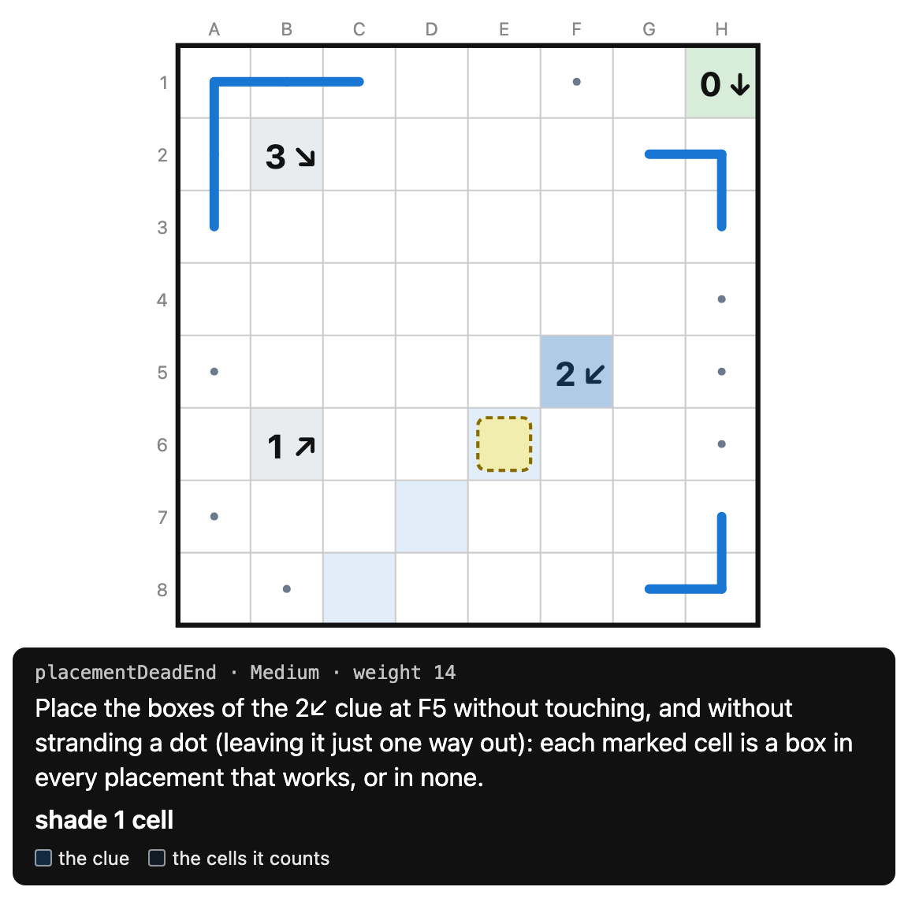</a>

*Y8x8_s50008_1, 8×8: the board after 11 earlier hints. Click the picture to open this puzzle and press Hint yourself.*

Hint says: "Place the boxes of the 2↙ clue at F5 without touching, and without stranding a dot (leaving it just one way out): each marked cell is a box in every placement that works, or in none."

---

### shadeShortChain

*Medium, cost 15*

The easy cases of `shadeForcesLines`: the imagined box makes one cell end up with three lines, and only a couple of the forced lines are needed to get there (at most 2, `SHORT_CHAIN` in `js/rating.js`; a cell with two ways out draws both lines, but only the one that feeds the contradiction counts). Longer or messier contradictions (a stranded cell, two separate cells filled, the loop closing early) are left to `shadeForcesLines` and `shadeClosesLoop`, which are Hard. Hint draws just the lines that matter, dashed

<a href="https://joshmermelstein.com/yajilin/index.html?book=armory&puzzle=12">
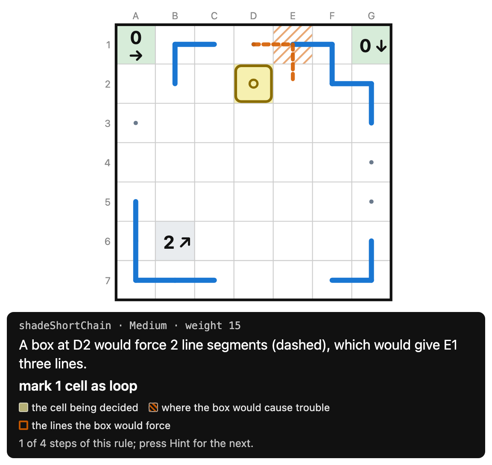</a>

*Y7x7_s32005_4, 7×7: the board after 12 earlier hints. Click the picture to open this puzzle and press Hint yourself.*

Hint says: "A box at D2 would force 2 line segments (dashed), which would give E1 three lines."

---

### boxStarvesClue

*Medium, cost 16*

Imagine a cell shaded: boxes never touch, so its open neighbours would be dots. If that takes so many open cells out of a clue's line that the boxes it has plus the open cells it has left fall short of its number, the cell is a dot. E.g. a 1-arrow down a diagonal whose cells are F3, G4 and H5, with H5 on the loop: a box at G3 would turn F3 and G4 into dots and leave the arrow nothing to count, so G3 is a dot. Only the dots right next to the box count; `boxStarvesClueByLines` is the version that follows lines

<a href="https://joshmermelstein.com/yajilin/index.html?book=armory&puzzle=13">
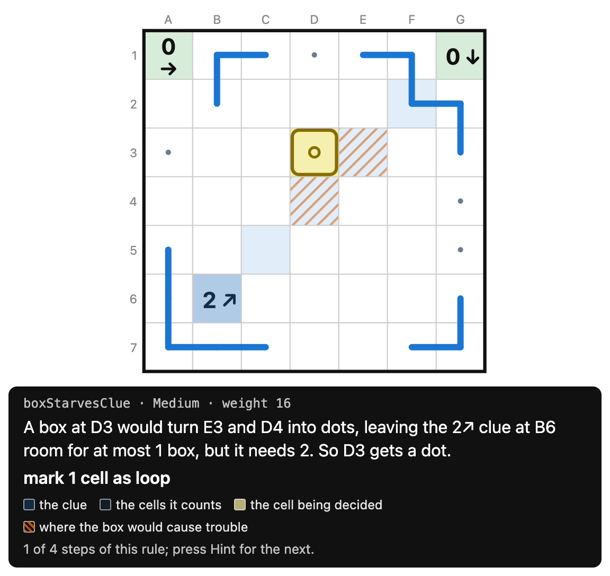</a>

*Y8x8_s22008_2, 8×8: the board after 15 earlier hints. Click the picture to open this puzzle and press Hint yourself.*

Hint says: "A box at D3 would put dots on E3 and D4, which violates the 2↙ clue at F2."

---

### closingNeighbor

*Medium, cost 20*

Imagine a cell shaded: its undecided neighbour would be a dot whose only two ways out lead to the two ends of one path, so using both would close the loop early. The cell is a dot (`closingCell` one step removed)

<a href="https://joshmermelstein.com/yajilin/index.html?book=armory&puzzle=14">
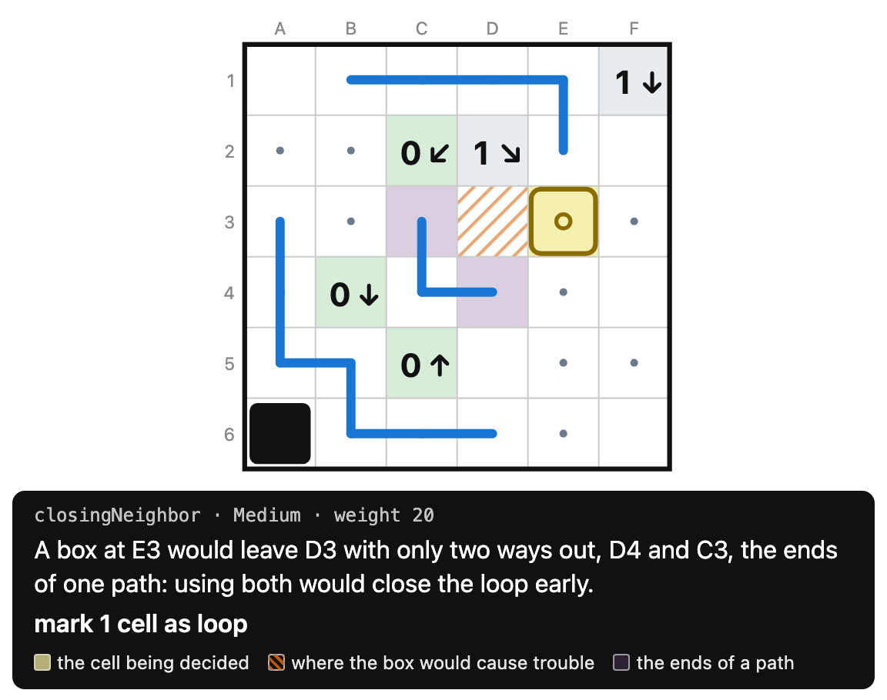</a>

*Y6x6_s8009_3, 6×6: the board after 19 earlier hints. Click the picture to open this puzzle and press Hint yourself.*

Hint says: "A box at E3 would leave D3 with only two ways out, D4 and C3, the ends of one path: using both would close the loop early."

---

### dotShortChain

*Medium, cost 21*

Imagine a **dot** on a cell that a clue counts and follow the easy consequences for at most 4 steps: a clue then needing every open cell it has left (or exactly every other one), dots next to boxes, dead ends, cells with two ways out using both. If that breaks something (boxes touch, a cell is stranded or gets three lines, a clue can't reach its number, the loop closes early, an area is cut off with an odd number of open ends), the cell is a box. The mirror of the "imagine a box" rules. E.g. a dot at I9 would make the 1← clue at L9 need J9, and the lines that follow cut off an area with 3 open ends

<a href="https://joshmermelstein.com/yajilin/index.html?book=armory&puzzle=22">
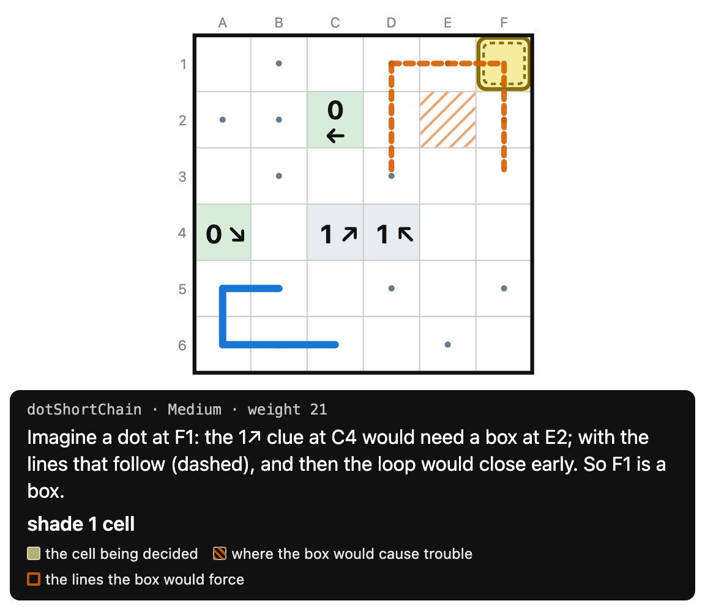</a>

*Y6x6_s9009_9, 6×6: the board after 15 earlier hints. Click the picture to open this puzzle and press Hint yourself.*

Hint says: "Imagine a dot at F1: the 1↗ clue at C4 would need a box at E2; with the lines that follow (dashed), and then the loop would close early. So F1 is a box."

---

### twoEndsJoin

*Medium, cost 22*

The easy case of `pairedEnds`: a sealed-off area has just two open ends, so they join each other, which makes their far ends the two ends of one path: nothing may join those (a segment between them, or a cell whose only two ways out they are)

<a href="https://joshmermelstein.com/yajilin/index.html?book=armory&puzzle=18">
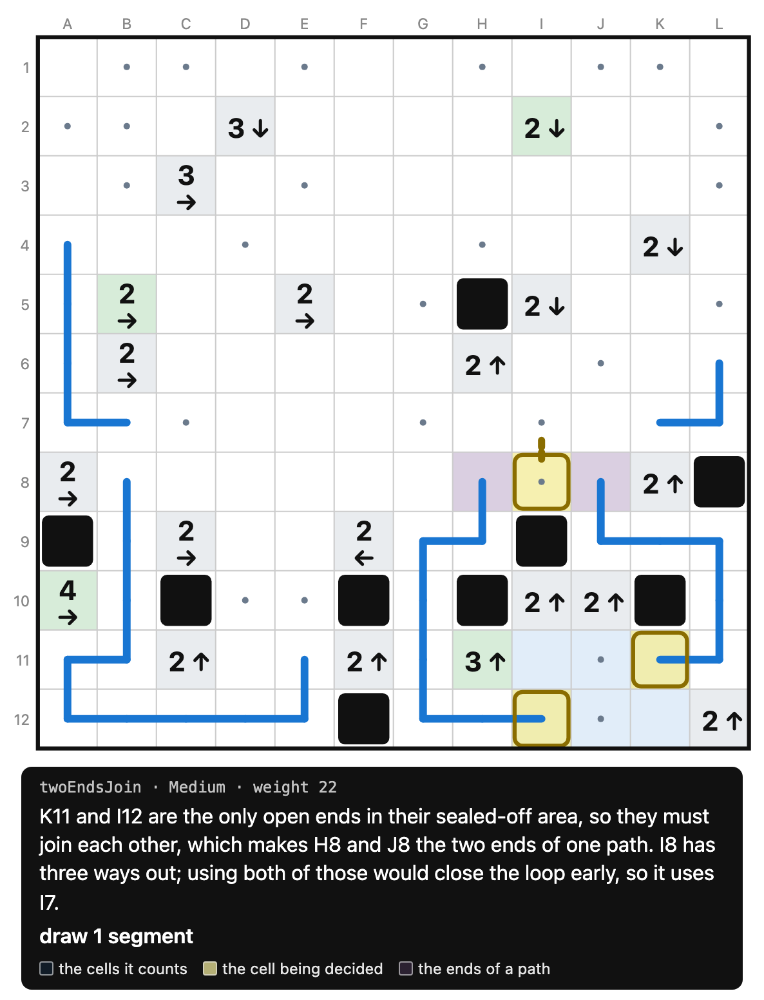</a>

*Y12x12_s9408_8, 12×12: the board after 64 earlier hints. Click the picture to open this puzzle and press Hint yourself.*

Hint says: "K11 and I12 are the only open ends in their sealed-off area, so they must join each other, which makes H8 and J8 the two ends of one path. I8 has three ways out; using both of those would close the loop early, so it uses I7."

---

### chokepoint

*Medium, cost 23*

(Josh's "two gates") imagine a segment missing or a box: if that leaves one cell as the only way between two parts of the board that both hold loop cells, the loop could not get in and back out (it passes through a cell once), so it is the other way. For a part of at most 12 cells. E.g. FRAME-IRR-MIX-10x10-1: the area G2-I3 joins the board through G3 and I3, so without the segment I3-I4, G3 would be the only way in, and I3 goes down. Also part of the contradiction check, so trial and error knows it

<a href="https://joshmermelstein.com/yajilin/index.html?book=armory&puzzle=23">
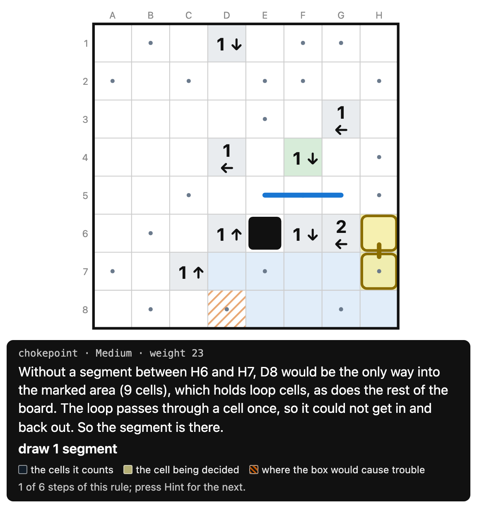</a>

*Y8x8_s9197_14, 8×8: the board after 22 earlier hints. Click the picture to open this puzzle and press Hint yourself.*

Hint says: "Without a segment between H6 and H7, D8 would be the only way into the marked area (9 cells), which holds loop cells, as does the rest of the board. The loop passes through a cell once, so it could not get in and back out. So the segment is there."

---

### rangeSame

*Medium, cost 24*

Two clues in a line point the same way with two or more cells between them: those cells hold (first number - second number) boxes; use that range like a clue

<a href="https://joshmermelstein.com/yajilin/index.html?book=armory&puzzle=15">
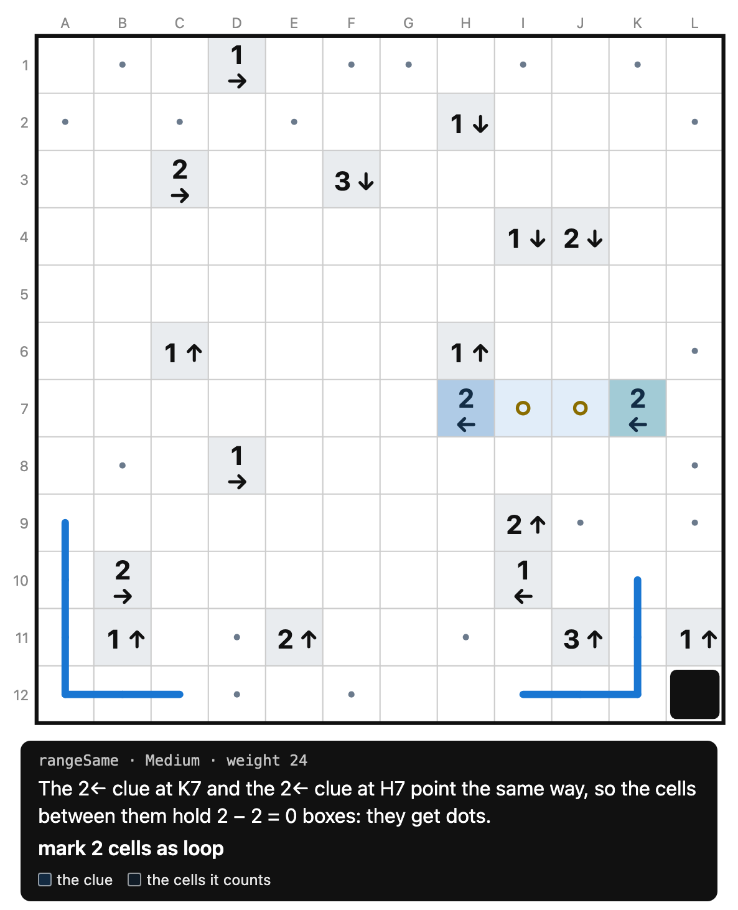</a>

*Y12x12_s9389_4, 12×12: the board after 29 earlier hints. Click the picture to open this puzzle and press Hint yourself.*

Hint says: "The 2← clue at K7 and the 2← clue at H7 point the same way, so the cells between them hold 2 − 2 = 0 boxes: they get dots."

---

### shadeFewLines

*Medium, cost 25*

`shadeForcesLines` when at most 3 of the forced lines matter (any kind: three lines or a stranded cell; `shadeShortChain` is the 2-line, three-lines case). About two in five of the old `shadeForcesLines` steps

<a href="https://joshmermelstein.com/yajilin/index.html?book=armory&puzzle=20">
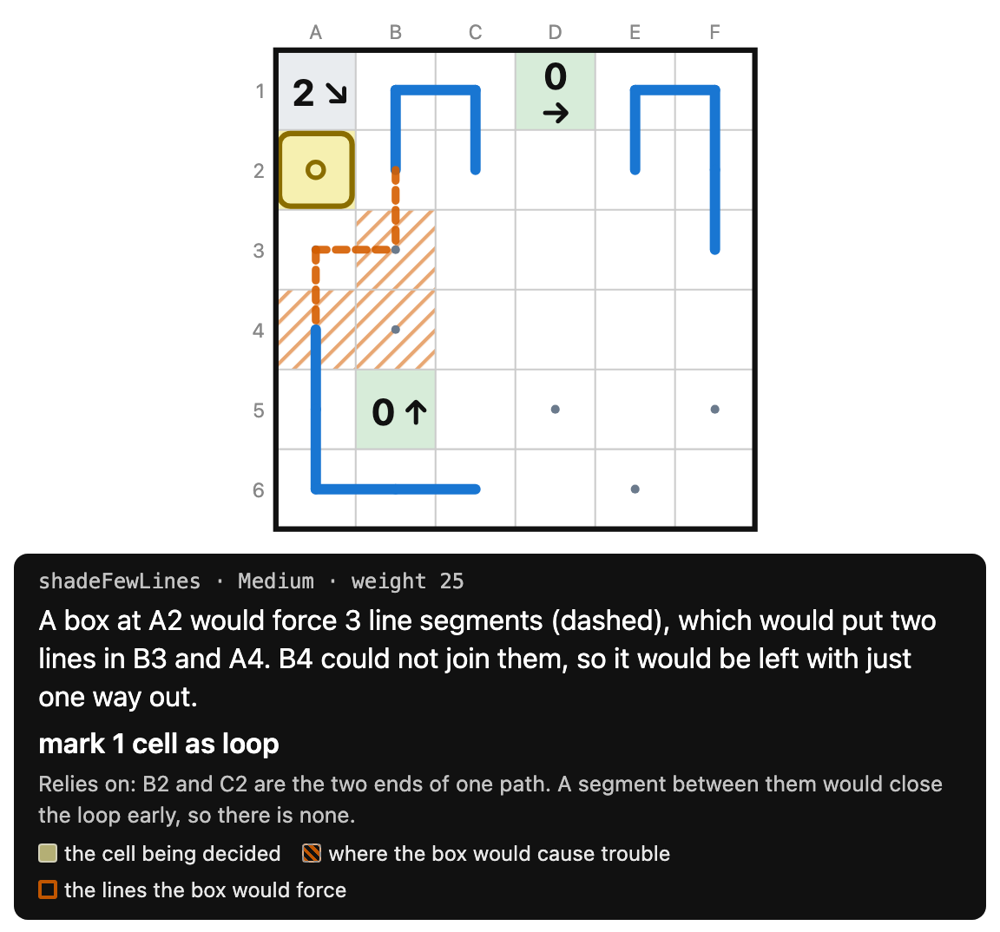</a>

*Y6x6_s32003_7, 6×6: the board after 16 earlier hints. Click the picture to open this puzzle and press Hint yourself.*

Hint says: "A box at A2 would force 3 line segments (dashed), which would put two lines in B3 and A4. B4 could not join them, so it would be left with just one way out."

---

### segmentShortChain

*Medium, cost 26*

`segmentForcesLines` when at most 2 of the forced lines matter (the lines the contradiction rests on, as Hint draws them)

<a href="https://joshmermelstein.com/yajilin/index.html?book=armory&puzzle=21">
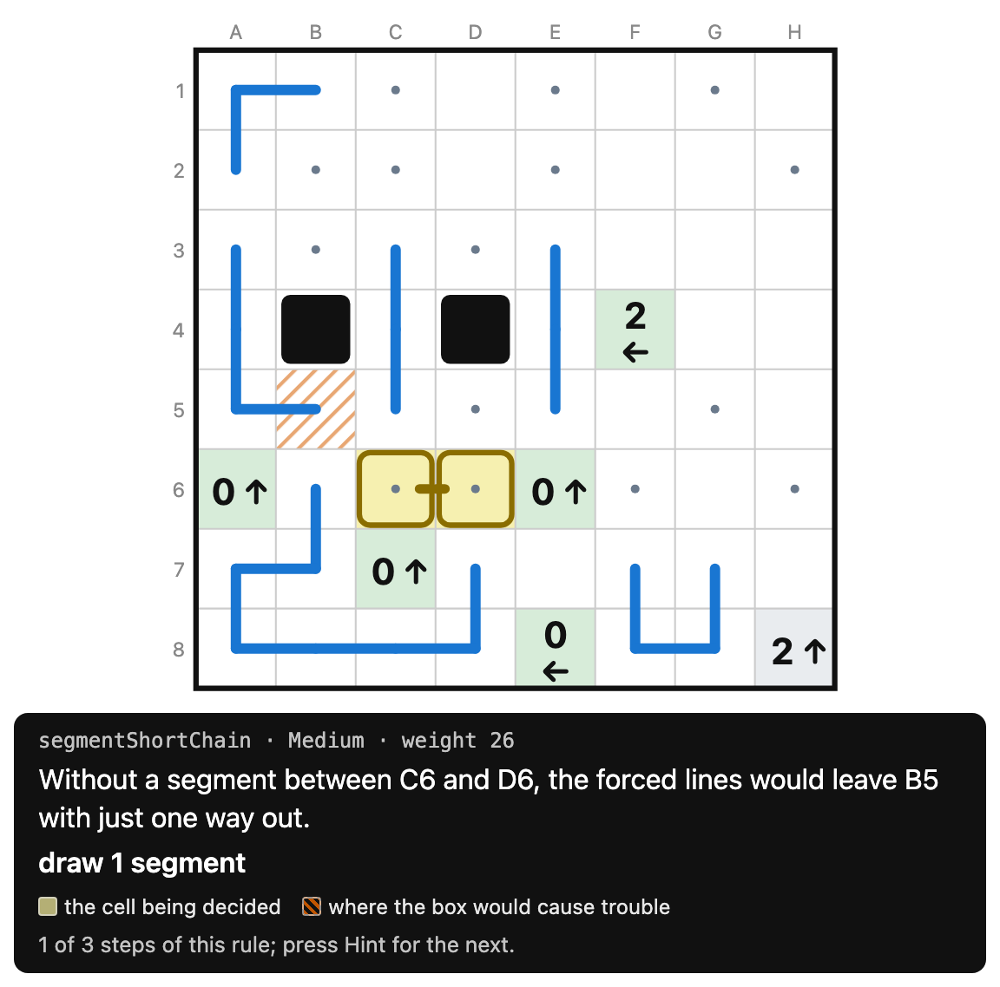</a>

*Y8x8_s12007_3, 8×8: the board after 29 earlier hints. Click the picture to open this puzzle and press Hint yourself.*

Hint says: "Without a segment between C6 and D6, the forced lines would leave B5 with just one way out."

---

### boxStarvesClueByLines

*Medium, cost 27*

The same imagined box, but the dots come further: a neighbour of the box that is left with exactly two ways out (a cell on the edge, say, with a box on its other side) must use both, and the cells at the far ends of those lines are dots too. Those forced lines are not as obvious as the dots next to a box, but it is one forced step, so it is late Medium (Hard until 2026-11-21) (which only counts the dots next to the box). E.g. a 1-arrow pointing left along the bottom row with B8 on the loop: a box at B7 leaves B8 only A8 and C8, so both are dots and the arrow has nothing to count; Hint draws the forced lines dashed

<a href="https://joshmermelstein.com/yajilin/index.html?book=armory&puzzle=17">
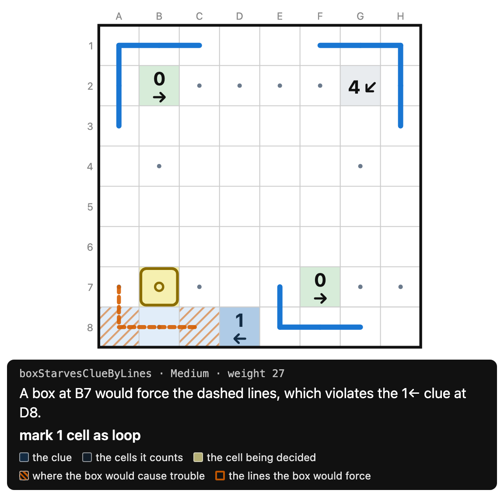</a>

*SPARSE-8X8-BOTH-30, 8×8: the board after 18 earlier hints. Click the picture to open this puzzle and press Hint yourself.*

Hint says: "A box at B7 would force the dashed lines, which violates the 1← clue at D8."

---

### rangeFacingKnown

*Medium, cost 28*

Two clues point at each other and so split the line into three parts: between them (seen by both) and beyond each (seen by one). When one part holds a known number of boxes (filled in, or no room for more), the other two follow (first = between + beyond second, second = between + beyond first); place them like clues

<a href="https://joshmermelstein.com/yajilin/index.html?book=armory&puzzle=16">
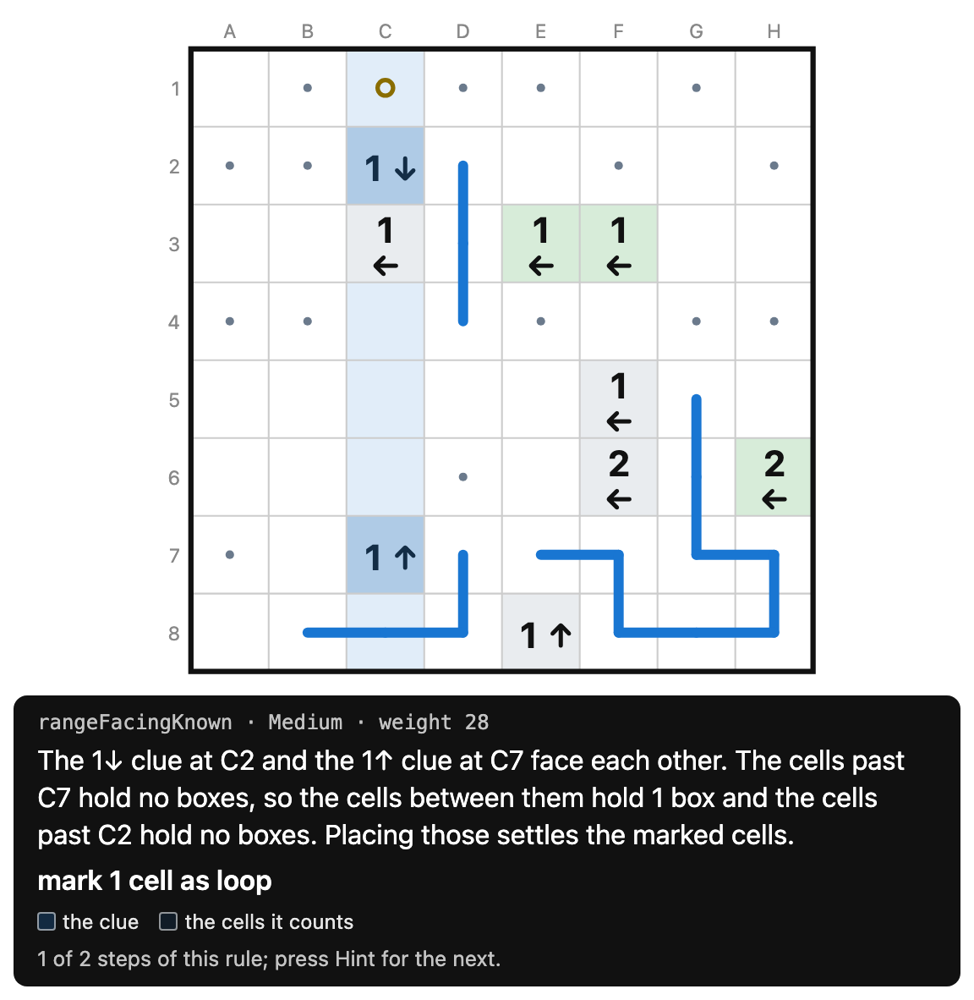</a>

*Y8x8_s9173_9, 8×8: the board after 30 earlier hints. Click the picture to open this puzzle and press Hint yourself.*

Hint says: "The 1↓ clue at C2 and the 1↑ clue at C7 face each other. The cells past C7 hold no boxes, so the cells between them hold 1 box and the cells past C2 hold no boxes. Placing those settles the marked cells."

---

### parityPocket

*Medium, cost 28*

`parityForces` when the area cut off is a small pocket: at most 3 open ends and 9 cells, so it can be seen at a glance

<a href="https://joshmermelstein.com/yajilin/index.html?book=armory&puzzle=19">
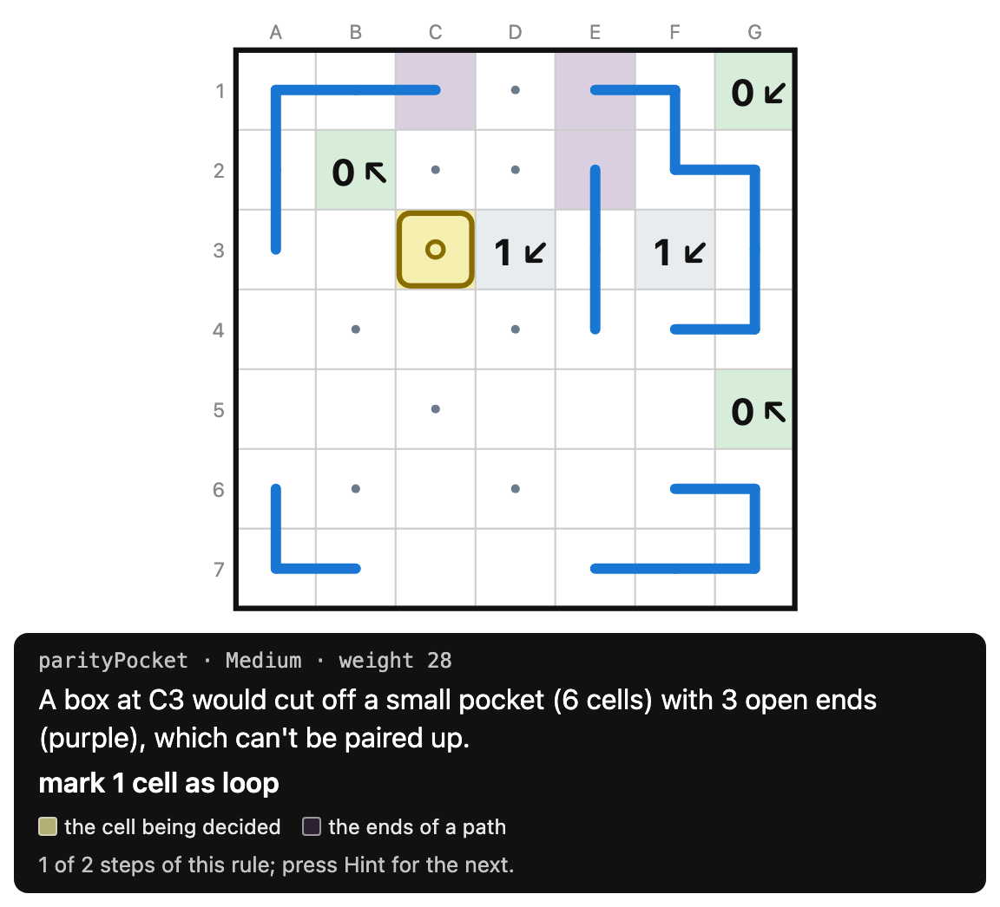</a>

*Y7x7_s22006_4, 7×7: the board after 24 earlier hints. Click the picture to open this puzzle and press Hint yourself.*

Hint says: "A box at C3 would cut off a small pocket (6 cells) with 3 open ends (purple), which can't be paired up."

---

## Hard

A puzzle is rated Hard when the hardest thing it needs is this: long chains of forced lines, counting with bounds along facing clues, parity of large areas, and at worst trial and error.

### regionPairs

*Hard, cost 45*

(regional puzzles) two neighbouring numbered regions together: every way to place both numbers of boxes without touching includes (or leaves out) a cell

*No picture: It applies to puzzles with regions, and none of the regional puzzles I searched shows it as the next hint.*

---

### rangeFacing

*Hard, cost 48*

The same when no part is exact: how many boxes fit in each part (bounds from the room each has) still pins how many each part holds. Moved before the chain rules on 2026-11-21 (it is counting along one line)

<a href="https://joshmermelstein.com/yajilin/index.html?book=armory&puzzle=24">
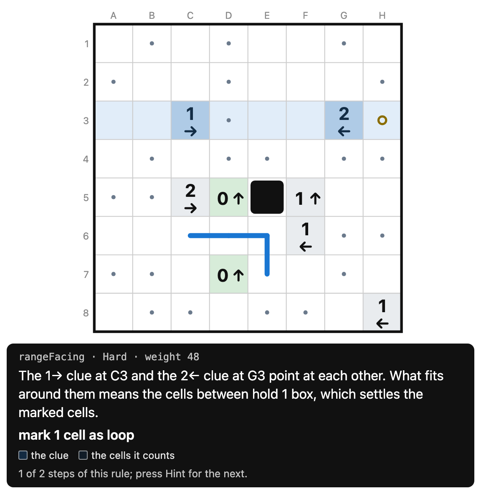</a>

*BONUS-LONGWAY-8X8-247, 8×8: the board after 24 earlier hints. Click the picture to open this puzzle and press Hint yourself.*

Hint says: "The 1→ clue at C3 and the 2← clue at G3 point at each other. What fits around them means the cells between hold 1 box, which settles the marked cells."

---

### colorBalance

*Hard, cost 50*

Colour the board like a chessboard: the loop alternates colours, so light boxes minus dark boxes is fixed (light cells minus dark cells); with the range of the total number of boxes (known in regional puzzles) that can fix how many boxes each colour holds, and settle a whole colour's open cells. Arrow puzzles too since 2026-11-21: there the total is open, so it only fires in endgames (in about 1 puzzle in 20 to 100)

<a href="https://joshmermelstein.com/yajilin/index.html?book=armory&puzzle=25">
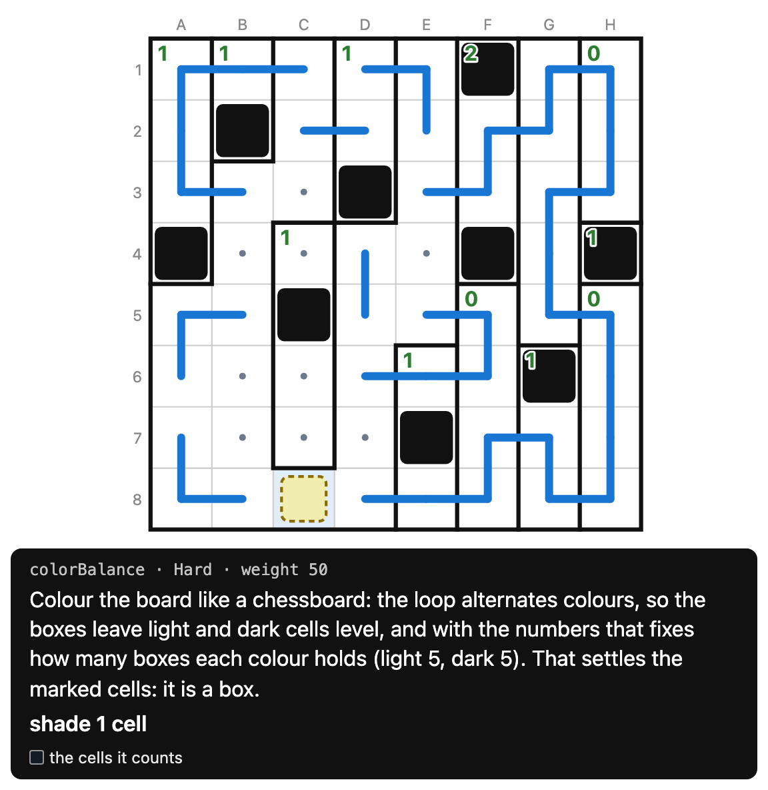</a>

*cols-8x8-2, 8×8: the board after 56 earlier hints. Click the picture to open this puzzle and press Hint yourself.*

Hint says: "Colour the board like a chessboard: the loop alternates colours, so the boxes leave light and dark cells level, and with the numbers that fixes how many boxes each colour holds (light 5, dark 5). That settles the marked cells: it is a box."

---

### chokepointArea

*Hard, cost 62*

`chokepoint` when the part cut off is larger than 12 cells

<a href="https://joshmermelstein.com/yajilin/index.html?book=armory&puzzle=27">
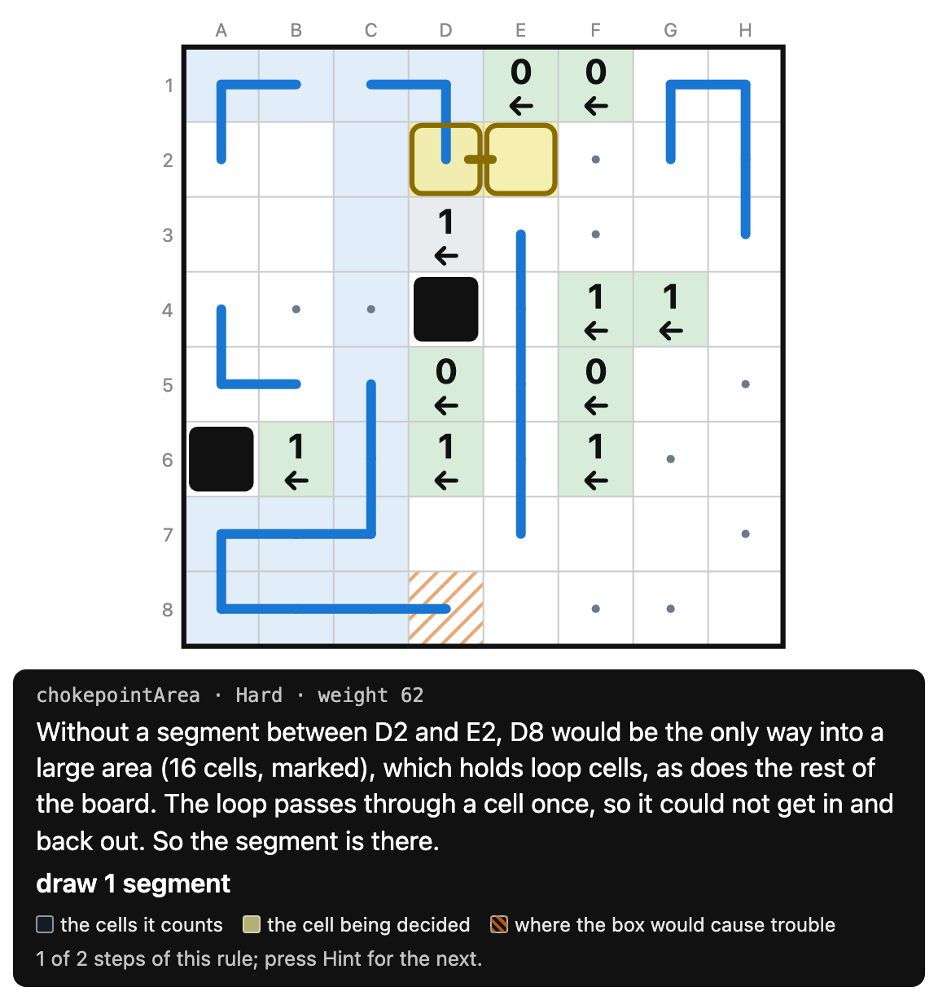</a>

*Y8x8_s9127_4, 8×8: the board after 34 earlier hints. Click the picture to open this puzzle and press Hint yourself.*

Hint says: "Without a segment between D2 and E2, D8 would be the only way into a large area (16 cells, marked), which holds loop cells, as does the rest of the board. The loop passes through a cell once, so it could not get in and back out. So the segment is there."

---

### shadeForcesLines

*Hard, cost 70*

(firings come shortest chain first) imagine a cell shaded and add the lines that forces (a loop cell with two exits uses both): if a cell ends up with three lines or too few ways out, the cell is a dot. The cases with at most 3 lines that matter are `shadeFewLines` (Medium); here the score adds 2 per line that matters past 3

<a href="https://joshmermelstein.com/yajilin/index.html?book=armory&puzzle=28">
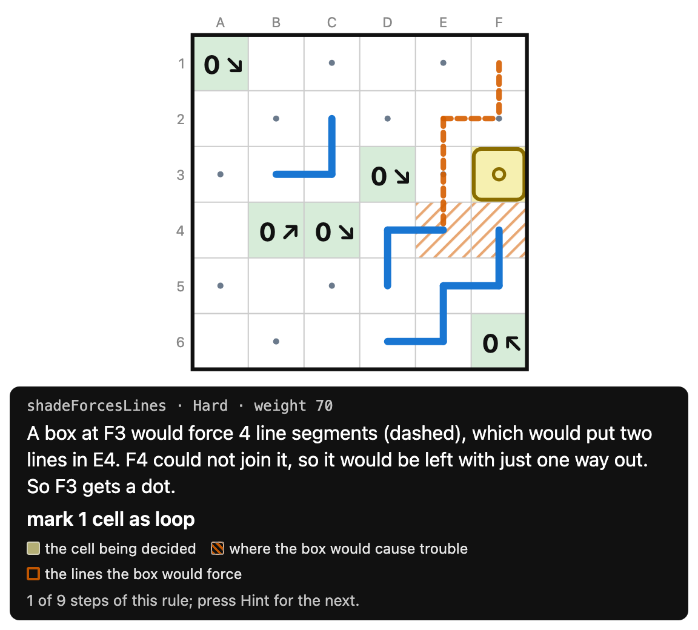</a>

*Y6x6_s32003_2, 6×6: the board after 15 earlier hints. Click the picture to open this puzzle and press Hint yourself.*

Hint says: "A box at E1 would force 4 line segments (dashed), which would give D2 three lines."

---

### boxStarvesClueByPlacements

*Hard, cost 72*

Imagine a cell shaded and follow only the lines it forces (as in `shadeForcesLines`); if some clue's line is then left without room for the boxes it still needs, the cell is a dot. Room is counted along the whole line in one pass (so long lines work, unlike `placementDeadEnd`): boxes never touch, and two cells one apart cannot both be boxes when the loop cell between them would keep fewer than two ways out. Hint: names the starved clue, the groups of cells that each hold at most one box, and draws the forced lines dashed (the column F argument of the logic-masters 20×20 puzzle)

<a href="https://joshmermelstein.com/yajilin/index.html?book=armory&puzzle=29">
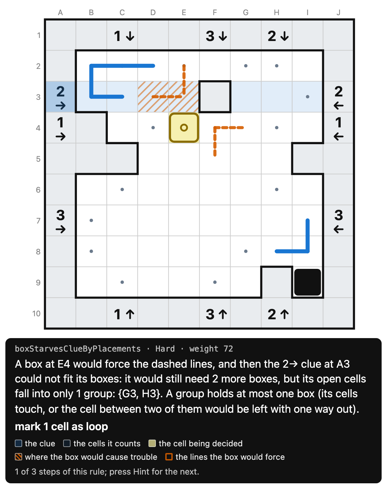</a>

*FRAME-irr_mix_10_a, 10×10: the board after 20 earlier hints. Click the picture to open this puzzle and press Hint yourself.*

Hint says: "A box at E4 would force the dashed lines, and then the 2→ clue at A3 could not fit its boxes: it would still need 2 more boxes, but its open cells fall into only 1 group: {G3, H3}. A group holds at most one box (its cells touch, or the cell between two of them would be left with one way out)."

---

### segmentStarvesClue

*Hard, cost 74*

`boxStarvesClueByPlacements` for a segment: imagine it drawn (or missing) next to the known loop and follow the forced lines; if the lines are fine but a clue's line is then left without room for its boxes (counted as in `boxStarvesClueByPlacements`), the segment is the other way

<a href="https://joshmermelstein.com/yajilin/index.html?book=armory&puzzle=29">
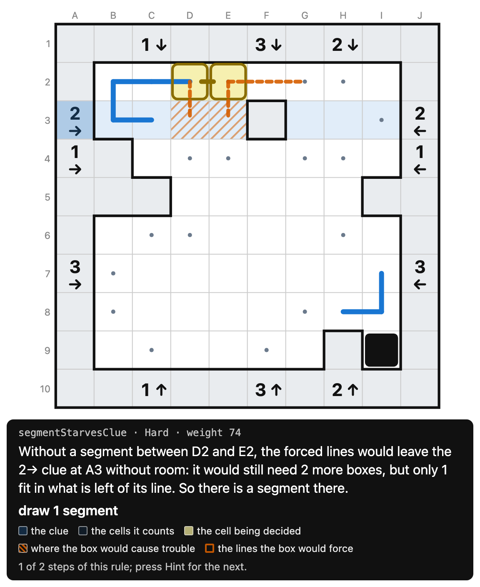</a>

*FRAME-irr_mix_10_a, 10×10: the board after 23 earlier hints. Click the picture to open this puzzle and press Hint yourself.*

Hint says: "Without a segment between D2 and E2, the forced lines would leave the 2→ clue at A3 without room: it would still need 2 more boxes, but only 1 fit in what is left of its line. So there is a segment there."

---

### shadeClosesLoop

*Hard, cost 75*

The same imagined box, but the forced lines close the loop while other loop cells lie outside it: the cell is a dot

<a href="https://joshmermelstein.com/yajilin/index.html?book=armory&puzzle=12">
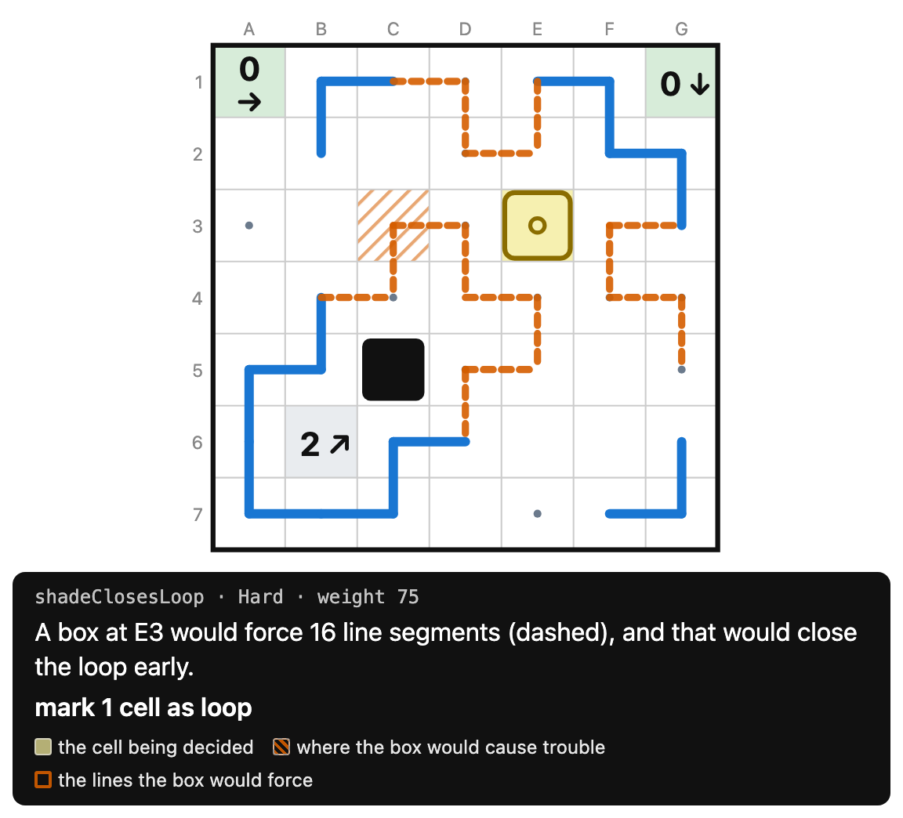</a>

*Y7x7_s32005_4, 7×7: the board after 25 earlier hints. Click the picture to open this puzzle and press Hint yourself.*

Hint says: "A box at E3 would force 16 line segments (dashed), and that would close the loop early."

---

### dotForcesLines

*Hard, cost 78*

`dotShortChain` with no limit on the steps; the score adds 2 per step past 4

<a href="https://joshmermelstein.com/yajilin/index.html?book=armory&puzzle=30">
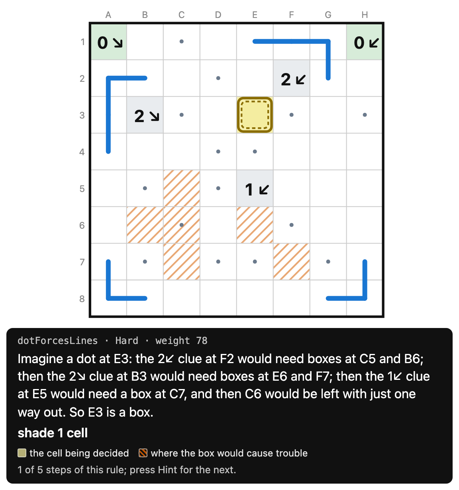</a>

*Y8x8_s22009_1, 8×8: the board after 17 earlier hints. Click the picture to open this puzzle and press Hint yourself.*

Hint says: "Imagine a dot at E3: the 2↙ clue at F2 would need boxes at C5 and B6; then the 2↘ clue at B3 would need boxes at E6 and F7; then the 1↙ clue at E5 would need a box at C7, and then C6 would be left with just one way out. So E3 is a box."

---

### segmentForcesLines

*Hard, cost 80*

`shadeForcesLines` for a segment: imagine it missing (or drawn) next to a loop cell and add the forced lines; if a cell is left with three lines or too few ways out, the segment is there (or is not). E.g. a dot with three ways out that cannot skip the left one without a contradiction uses it. The cases with at most 2 lines that matter are `segmentShortChain` (Medium); here the score adds 2 per line past 2

<a href="https://joshmermelstein.com/yajilin/index.html?book=armory&puzzle=31">
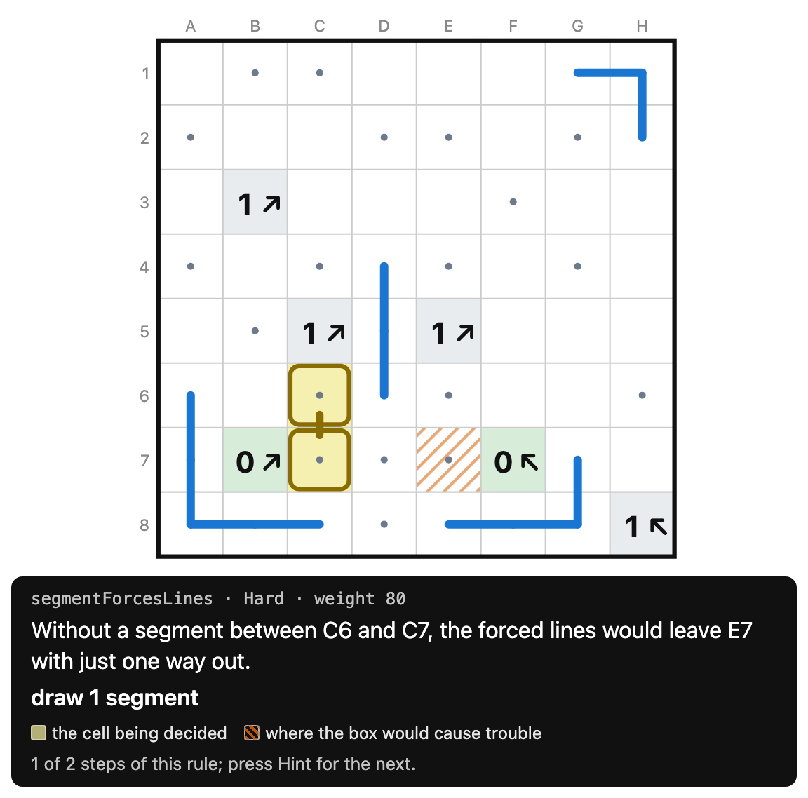</a>

*Y8x8_s22007_1, 8×8: the board after 26 earlier hints. Click the picture to open this puzzle and press Hint yourself.*

Hint says: "Without a segment between C6 and C7, the forced lines would leave E7 with just one way out."

---

### segmentClosesLoop

*Hard, cost 85*

The same imagined segment, but the forced lines close the loop early

<a href="https://joshmermelstein.com/yajilin/index.html?book=armory&puzzle=32">
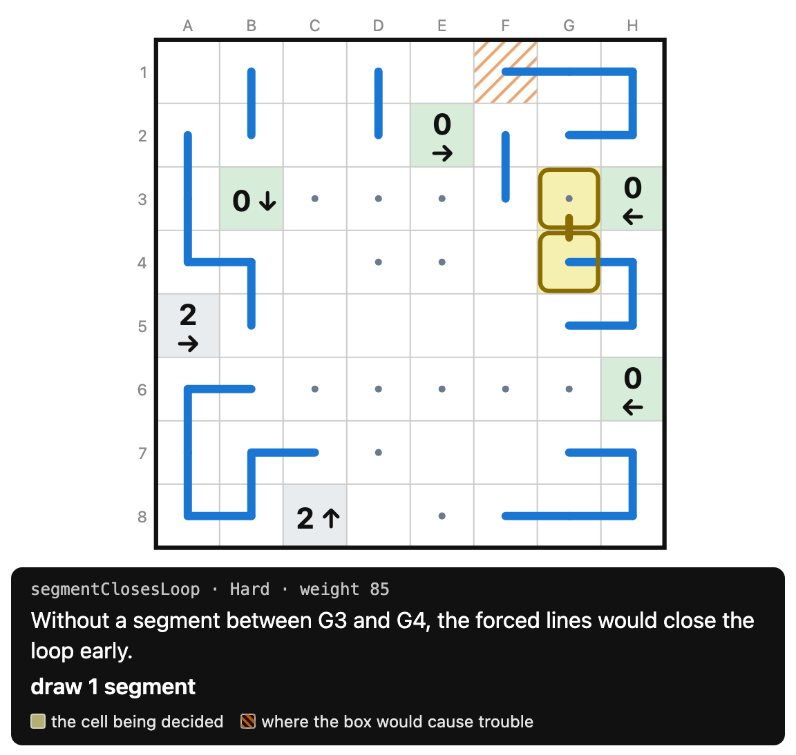</a>

*Y8x8_s12008_5, 8×8: the board after 35 earlier hints. Click the picture to open this puzzle and press Hint yourself.*

Hint says: "Without a segment between G3 and G4, the forced lines would close the loop early."

---

### crossingParity

*Hard, cost 90*

The loop crosses the border of any rectangle an even number of times (every loop cell has exactly two segments): when all but one crossing is settled, the last is forced. Checked for small rectangles, corner-anchored ones and full-width or full-height bands (janko.at's "parity rule 1": a row or column cut, and the quadrants of a row/column cross). Placed just before `parityForces`, so a cut is shown before a large area's count

<a href="https://joshmermelstein.com/yajilin/index.html?book=armory&puzzle=26">
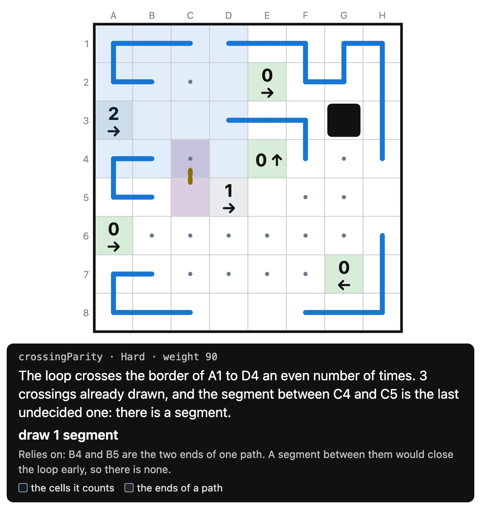</a>

*Y8x8_s12007_4, 8×8: the board after 35 earlier hints. Click the picture to open this puzzle and press Hint yourself.*

Hint says: "The loop crosses the border of A1 to D4 an even number of times. 3 crossings already drawn, and the segment between C4 and C5 is the last undecided one: there is a segment."

---

### parityForces

*Hard, cost 95*

A move (a cell shaded, a segment drawn or missing) would cut off a group of cells that can still be joined and holds an odd number of open ends (cells with one line that still need a second), which can never be completed: it is the other way. A small pocket is `parityPocket` (Medium); here the score adds 2 per open end past 3. Firings come smallest area first

<a href="https://joshmermelstein.com/yajilin/index.html?book=armory&puzzle=33">
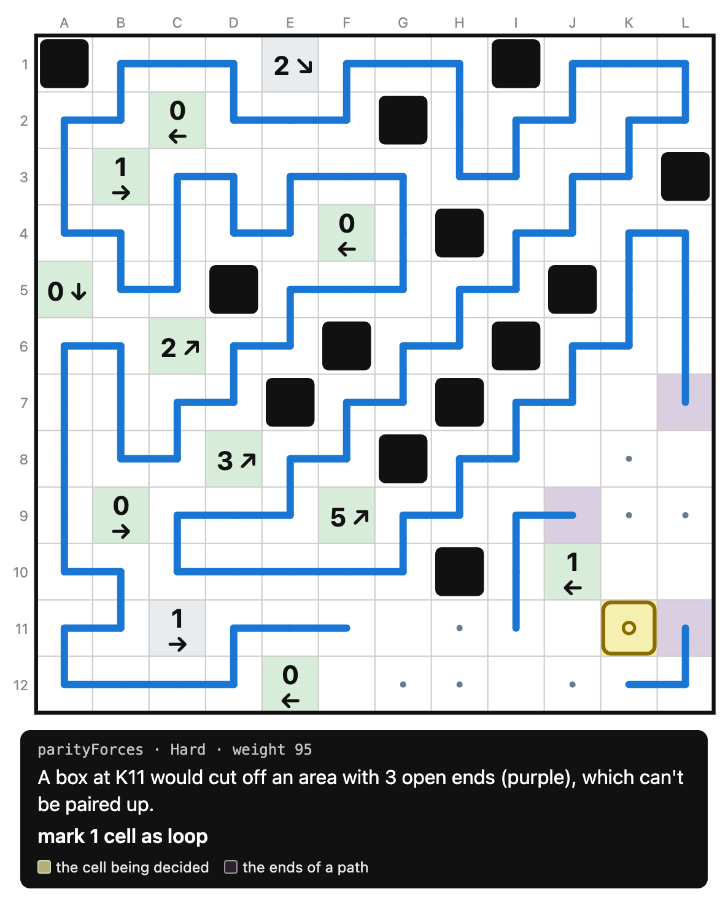</a>

*SPARSE-12X12-BOTH-24, 12×12: the board after 121 earlier hints. Click the picture to open this puzzle and press Hint yourself.*

Hint says: "A box at K11 would cut off an area with 3 open ends (purple), which can't be paired up."

---

### pairedEnds

*Hard, cost 110*

The same with four or six open ends: list every way to pair them up, drop those that close the loop early (e.g. joining the two ends of one little path), and see what is left in common: in every remaining pairing two ends outside the group become the two ends of one line, so a segment between them is not there. (Two open ends: `twoEndsJoin`)

*No picture: Only the versions with four or six open ends are left under this name (with two open ends it is `twoEndsJoin`), and since 2026-11-21 none of the puzzles I searched (every book, plus the generator's library) reaches one as the next hint: the cheaper rules finish those positions first.*

---

### uniqueRoute

*Hard, cost 125*

**assumes the puzzle has one solution.** A group of cells that can still be joined, all of them known loop cells, holds open ends that must be paired up through it. A pairing that can be drawn two different ways over the same cells would give two solutions (the boxes, so the clue counts, do not change), so it is not the real one; what is left may settle segments. E.g. two dots side by side between two open ends above and two below: they cannot join each other

<a href="https://joshmermelstein.com/yajilin/index.html?book=armory&puzzle=31">
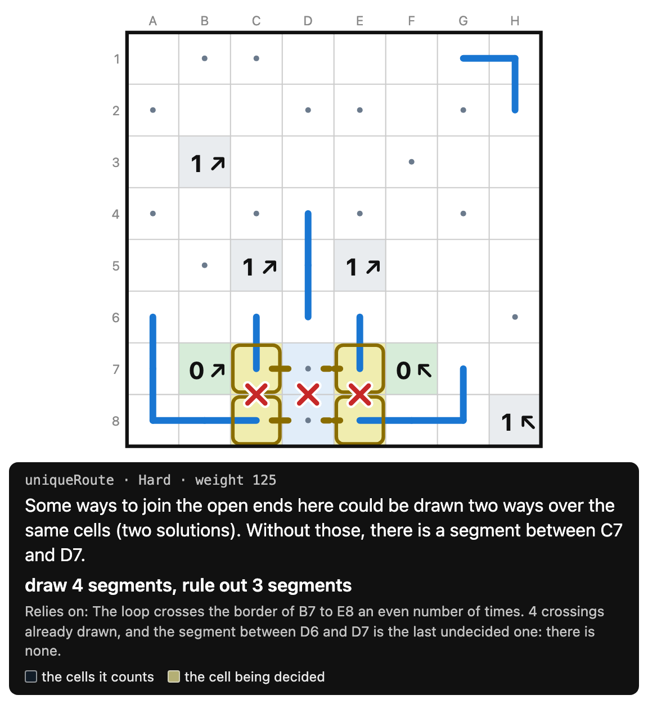</a>

*Y8x8_s22007_1, 8×8: the board after 28 earlier hints. Click the picture to open this puzzle and press Hint yourself.*

Hint says: "Some ways to join the open ends here could be drawn two ways over the same cells (two solutions). Without those, there is a segment between C7 and D7."

---

### tryCell

*Hard, cost 140*

Assume a cell is shaded (loop), follow the rules above to a contradiction: it is the other. The score adds 2 per step of the chain it follows (an 8-step trial costs 156, an 80-step one 300)

<a href="https://joshmermelstein.com/yajilin/index.html?book=armory&puzzle=34">
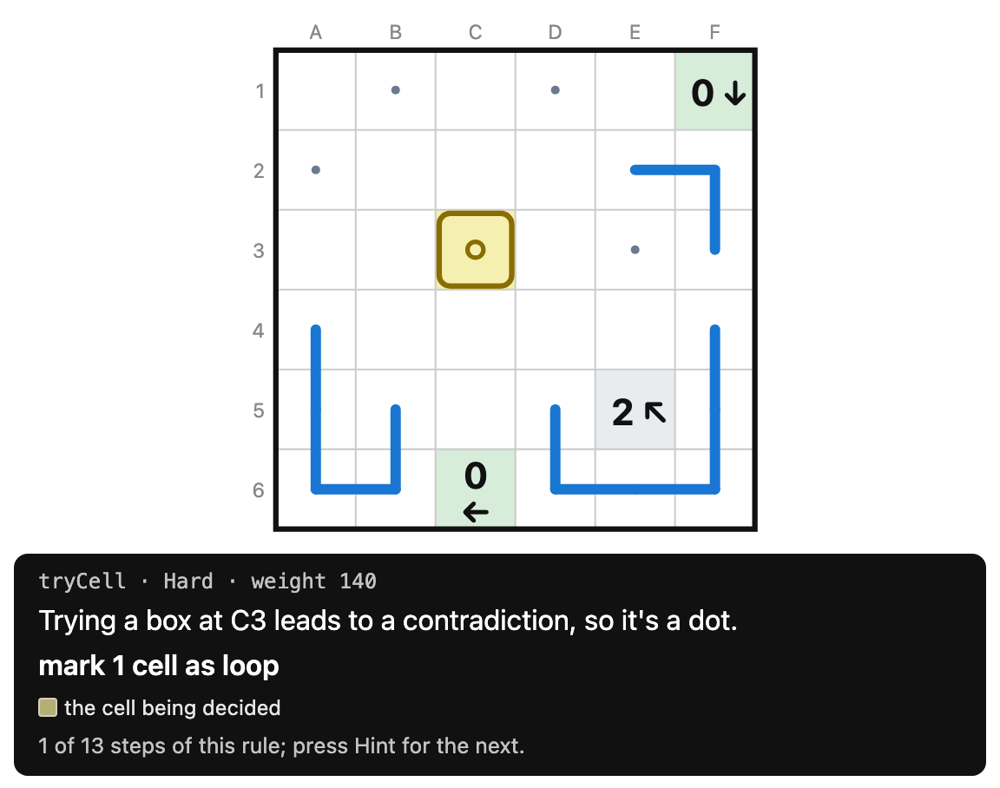</a>

*Y6x6_s32001_4, 6×6: the board after 14 earlier hints. Click the picture to open this puzzle and press Hint yourself.*

Hint says: "Trying a box at C3 leads to a contradiction, so it's a dot."

---

### tryEdge

*Hard, cost 160*

The same for a segment (on / off); the score adds 2 per step of the chain, as for `tryCell`

*No picture: It is the most expensive rule, and none of the puzzles I searched needs it as the next hint any more: `tryCell` and the cheaper rules finish them first.*

---
